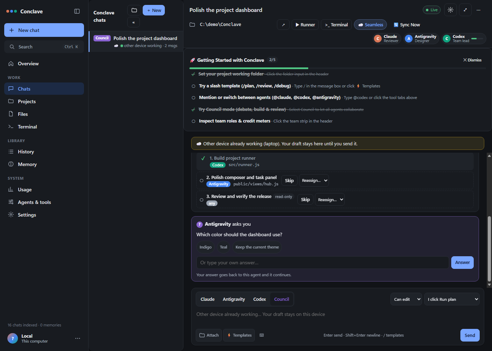
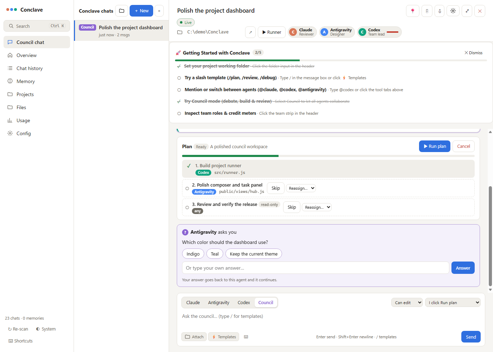
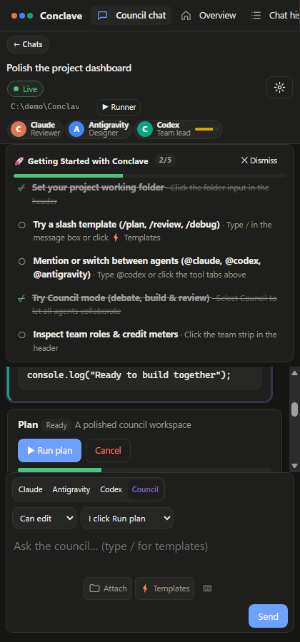

<div align="center">

# Conclave

**Your AI coding council, in one workspace.**

Bring Claude Code, Antigravity and Codex together to discuss, build and review your projects — with shared context and a task board you can follow.

[](package.json)
[](#your-data--access)
[](#shared-memory)
[](LICENSE)

[**Get started**](#get-started) · [Features](#features) · [Self-hosting](docs/RASPBERRY_PI.md) · [Roadmap](ROADMAP.md) · [Report an issue](https://github.com/Rohan-Reyes/TheConclave/issues)



<sub>Screenshots show a demo workspace with synthetic data.</sub>

</div>

## Why Conclave

- **One conversation, several perspectives.** Work with one agent, hand a task to another, or bring the council together to compare approaches and review changes.
- **From discussion to delivery.** Turn a verdict into a plan with dependencies, assigned roles, progress and questions. Pause, retry or reassign steps as you go.
- **Context that stays with the work.** Search your agents' local histories and share project memories through MCP, including from terminal sessions.
- **Run it on your own machine.** Chats, plans and memories live in local SQLite storage. Your installed agent CLIs handle model access through your existing accounts.

## Screenshots

<table>
  <tr>
    <td align="center" width="72%" valign="top">
      <a href="docs/screenshots/council-light.png"></a><br>
      <sub><b>Council workspace</b><br>Plans, agent roles and questions in one view</sub>
    </td>
    <td align="center" width="28%" valign="top">
      <a href="docs/screenshots/council-mobile.png"></a><br>
      <sub><b>Mobile layout</b><br>Keep the conversation within reach</sub>
    </td>
  </tr>
</table>

## Features

| | What you can do |
| --- | --- |
| **Council & handoffs** | Debate an approach, let a lead build and other agents review, or switch agents within a shared conversation. |
| **Plans & controls** | Track dependencies and assigned steps; pause, cancel, retry, skip or reassign work. Choose Auto, Ask on risk or Manual execution. |
| **Agents & roles** | Pick models, effort and team roles. Configure additional CLI agents alongside the three built-in integrations. |
| **History & search** | Search Claude Code, Antigravity and Codex transcripts, resume sessions in a terminal and hand context between agents. |
| **Shared memory** | Keep searchable project facts in SQLite and make them available through the included MCP server. |
| **Projects & files** | Browse projects and Git status; upload, create, rename and edit workspace files with conflict detection. |
| **Terminal & runner** | Use an interactive browser terminal or run project scripts and saved commands with live logs, stop/restart controls and links to local apps. |
| **Diffs & revert** | Inspect changes per reply and revert snapshots when later edits do not conflict. |
| **Usage & failover** | View available usage information and hand work to another agent when a quota is exhausted. Missing usage is shown as unknown. |
| **Tools & configuration** | Manage MCP connections, skills and global instruction files with preview diffs and backups. |
| **Everyday conveniences** | Persistent drafts, attachments, prompt templates, pinned/archived chats, Markdown export, notifications, keyboard shortcuts and light/dark themes. |
| **Owner access** | For private remote hosting, use owner login, passkeys and session controls behind your HTTPS origin. |

## Get started

You need **Git**, **npm** and **Node.js 22.23.4 or newer with SQLite FTS5**. The pinned version is in [`.nvmrc`](.nvmrc). Older Node builds can include `node:sqlite` without the full-text search module Conclave needs.

The desktop workflow is currently tested on **Windows**. Install and sign in to the agent CLIs you want to use separately; model subscriptions and API credits are supplied through those tools. Windows Terminal is needed for terminal-resume actions; VS Code is optional.

```powershell
git clone https://github.com/Rohan-Reyes/TheConclave.git
cd TheConclave
npm ci
npm start
```

Open **http://127.0.0.1:4777**. On Windows, `start.cmd` also opens the browser.

1. Open **Agents & tools → MCP servers** and connect the shared memory server to your installed tools. Restart existing agent sessions to load the connection.
2. Start a new chat and choose a project folder, or start a quick chat in a dedicated folder under `~/Conclave/`.
3. Choose an agent or **Council**, set the model, effort and roles, then describe the work.
4. Review the conversation, plan and diffs. Answer agent questions directly in their question cards.

<details>
<summary>Use a different port</summary>

```powershell
$env:CONCLAVE_PORT = '4780'
npm start
```

Open that port manually. Keep `CONCLAVE_PORT` consistent in the agent and MCP environments; the web server also accepts `PORT`. Finish active agent turns before restarting the app that hosts them.

</details>

## How the council works

**Discuss → Decide → Plan → Build → Review.** In Debate mode, agents compare answers and produce a verdict that can become a task plan. In Build & review mode, a lead makes changes and other agents inspect the actual files before the lead addresses their feedback.

| Execution mode | Behavior |
| --- | --- |
| **Auto** | Starts a validated plan after the verdict. This is the default. |
| **Ask on risk** | Requests additional approvals where the agent supports them. |
| **Manual** | Waits for you to select **Run plan**. |

Access is configured separately: read only, edit in folder or full access, with direct or sandboxed terminal access. Browser permission cards currently work for Claude; Codex and Antigravity use their CLI access modes. Custom agents must enforce their own permissions.

Plan assignment accounts for roles, effort and available usage. Writes to a project folder are serialized; independent read tasks can run concurrently. Full worktree isolation is still planned. Quota handoffs preserve partial work, while launch failures and stalls are reported separately from exhausted credits.

<details>
<summary>Questions, restart recovery and change tracking</summary>

- Questions have choices and a free-text answer, routed to the requesting task. Cancelled or superseded tasks reject stale answers. Clarification cards are separate from Claude's tool-permission cards.
- Completed plan steps survive a restart. Interrupted read steps return to the queue; a build step interrupted while editing waits for **Retry** or **Skip**. Automatic recovery requires Auto mode, write access and a plan with no interrupted edit or failed build step.
- Git snapshots use a temporary index to preserve your staging area. Conflicting later edits prevent a revert. Diff capture skips the home folder and large non-Git folders with more than 4,000 files.
- Usage support varies by agent. Expired limit windows are ignored, displayed percentages are capped at 100%, and Copilot usage reflects its latest recorded session rather than account-wide billing totals.

</details>

## Your data & access

Conclave listens on **127.0.0.1** and checks request hosts and origins. Chats, plans, history indexes and shared memories are stored locally in `data/hub.db`; configuration backups go in `backups/`. Model providers receive the context sent through their CLIs.

For private remote access, configure **owner login and an HTTPS public origin** before connecting a tunnel. See the [Raspberry Pi deployment guide](docs/RASPBERRY_PI.md) for authentication, storage paths and service setup. The app refuses a public-origin configuration without owner credentials.

The app and browser terminal can execute commands with the host account's access. The Files workspace boundary does not confine agent or administrative commands. Keep private databases, backups, logs and credentials out of Git; the repository's ignore rules exclude these local artifacts.

<details>
<summary>File uploads and attachment handling</summary>

The Files page uses `CONCLAVE_FILES_ROOT` (default `~/Conclave`) and supports UTF-8 text editing with conflict detection. See the deployment guide for file limits and boundary checks.

Chat attachments are limited to 4 MB combined per batch. Supported raster images retain an image extension; text, source, HTML and SVG uploads are stored as inert `.txt` files under the project's `.conclave/attachments/`. Add `.conclave/` to other projects' ignore files before committing them.

Codex receives uploaded raster images through native image input; Claude and Antigravity receive file paths. The composer indicates compatibility.

</details>

## Shared memory

The included [MCP server](mcp/memory-server.js) lets connected agents search and maintain memories, retrieve project context, ask you questions and consult other agents or the council. Connect it through **Agents & tools → MCP servers**.

Memory tools include `memory_search`, `memory_get`, `memory_add`, `memory_update`, `memory_delete`, `memory_list_recent` and `project_context`. In-chat agents receive thread/task IDs so `ask_user` returns answers to the correct task; structured question blocks provide a fallback when tool access is unavailable.

## Development

```powershell
npm test
node scripts/test-plans.mjs
node scripts/test-mcp.mjs
```

The default tests use temporary databases, fake agents and local processes without paid model calls. They cover plan execution, permissions, question routing, failover, recovery, runner lifecycle, configuration and diff/revert behavior.

Before committing, stage explicit source files and run `npm run scan:staged` to check indexed files for private artifacts and recognized credential patterns. Review the diff as well.

<details>
<summary>Browser checks and live-agent tests</summary>

`node scripts/check-ui.mjs --isolated` checks desktop, phone, landscape and reduced-height layouts in both themes with stubbed requests and no agent calls. To create a synthetic screenshot fixture, `scripts/seed-demo.mjs` requires isolated `AGENT_HUB_DB` and `AGENT_HUB_DATA_DIR` paths. Use synthetic data for public screenshots.

Mobile checks emulate phone sizes in a desktop browser. Physical iOS/Android keyboards, browser chrome, safe areas and touch behavior remain unverified.

`npm run test:live` calls configured agents and can consume credits. Other historical live scripts also require configured agents or a running server and are separate from `npm test`.

If `.github/workflows/` is absent, run checks locally; publishing the prepared CI workflow requires a GitHub credential with `workflow` scope.

</details>

## Project layout

```text
src/        Server logic, agent adapters, plans, memory and configuration
public/     Browser UI, terminal, project views and styles
mcp/        Shared memory and agent consultation server
scripts/    Local launch helpers, checks and demo fixtures
test/       Automated tests
docs/       Deployment guide and demo screenshots
server.js   Web server entry point
```

## Contributing

[Report a bug or suggest a feature](https://github.com/Rohan-Reyes/TheConclave/issues), or open a pull request with a focused change and relevant validation. See the [roadmap](ROADMAP.md) for planned work, including broader approval support, worktree isolation and physical-device testing.

## License

[MIT](LICENSE). Made by Rohan Reyes · [ATEN Systems](https://aten-systems.site).
