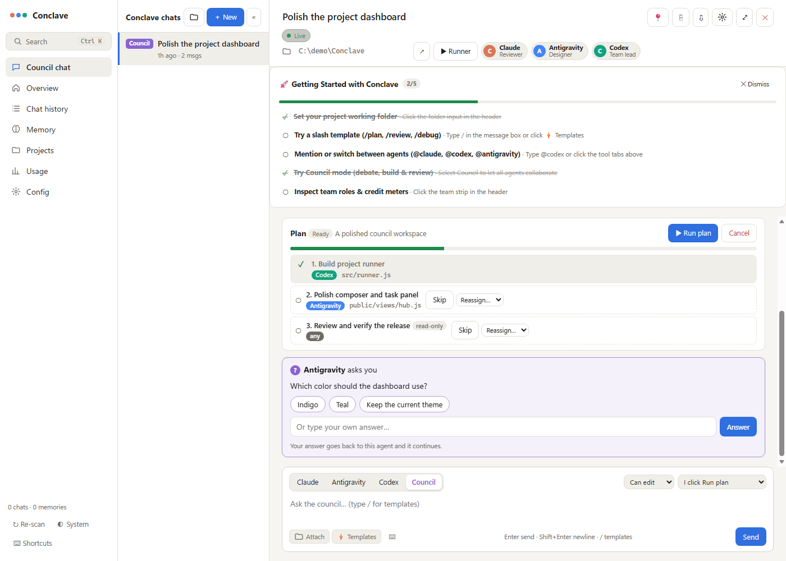

# Conclave

Your AI coding council: Claude Code, Antigravity and Codex together in a local app.
Discuss a change, turn the verdict into a task board, and let available agents build and review it with shared context.



[Dark theme](docs/screenshots/council-dark.png) · [Mobile layout](docs/screenshots/council-mobile.png)

## Get started

Conclave is currently tested on **Windows**, with **Node.js 22.23.4 or newer with SQLite FTS5**, npm and Git. Use the version in `.nvmrc`; older Node builds can lack the full-text search module even when `node:sqlite` exists. Windows Terminal is needed for terminal-resume actions; VS Code is optional. Install and sign in to the agent CLIs you want to use separately. Conclave does not include model subscriptions or API credits.

```powershell
git clone https://github.com/Rohan-Reyes/TheConclave.git
cd TheConclave
npm ci
npm start
```

Open **http://127.0.0.1:4777**. On Windows, `start.cmd` also opens the browser. In Config, connect the shared memory server to the installed tools, then restart their existing sessions to load that connection.

Start a quick chat without choosing a folder, or select an existing project. Quick chats use a dedicated folder under `~/Conclave/`. Select one agent or Council, choose models/effort and team roles, then send a request.

To use a different port in PowerShell:

```powershell
$env:CONCLAVE_PORT = '4780'
npm start
```

Open that port manually. Keep `CONCLAVE_PORT` consistent in agent/MCP environments when changing it; `PORT` is also accepted by the web server. If updating an app that is hosting an active agent, finish the turn before restarting the server.

## Council workflow

- **Auto** starts a validated plan after the verdict; it is the default. **Ask on risk** requests additional approvals where the agent supports them. **Manual** waits for Run plan.
- Access is a separate setting: read only, edit in folder, or full access. Terminal access can be direct or sandboxed. Direct terminal mode grants broad command access; choose sandboxed access when you need tool-enforced limits.
- Verdict cards retain their **Run plan** button. Plans track dependencies, estimated effort, assigned agents, progress, questions and failures. Pause, cancel, retry, skip or reassign steps.
- Assignment accounts for effort, agent roles and usage limits. One agent writes to a project folder at a time; independent read tasks can run concurrently. A quota takeover preserves partial work and tells the replacement to inspect it first.
- Questions appear in separate cards with choices and a text answer. Answers return to the requesting task. Cancelled or superseded tasks reject stale answers. Claude's tool-permission cards are separate from clarification questions.
- Per-reply diffs include Revert. Git snapshots use a temporary index, preserving your staging area; conflicting later edits prevent an unsafe revert.

## Everyday tools

- Unified, searchable history for the three built-in tools, with terminal resume and cross-agent handoffs.
- Composer templates, persistent drafts, attachments, copied code blocks, pinned/archived chats and edit/resend. Codex receives uploaded raster images through its native image input; Claude reads paths and Antigravity receives file paths.
- A **project runner** for package.json scripts and saved executable/argument pairs: run, stop, restart, capped live logs, loopback app links, and sending logs to chat. The first run confirms the exact command; package manifest changes invalidate script approval. npm scripts themselves may invoke a shell, as normal npm scripts do.
- Team roles, model/effort selection, usage screens and automatic quota failover. Waiting chats can resume after a known reset.
- Shared memories, project navigation, config diffs/backups, notifications, Markdown export and keyboard shortcuts.

## Local data and access

Conclave listens on **127.0.0.1 only** and checks request hosts and origins. It has no remote-login layer; do not expose its port through a tunnel or reverse proxy. The app can run commands and change project files with your agents' existing access.

| Area | Reads | Writes |
| --- | --- | --- |
| History | Installed agents' local transcripts and usage | Search index in `data/hub.db` |
| Memory | Shared database; optional import of Claude memory files | Shared memories in `data/hub.db` |
| Council chats | Conversation context and chosen project | Messages, plans/questions, native agent sessions and authorized project edits |
| Config | MCP settings, skills and instruction files | Explicit config edits; previous versions in `backups/` |
| Runner | Project package.json and saved commands | Ignored runner settings/logs; started commands may modify the project |
| Attachments/drafts | Files selected or pasted by you | Project attachment files; browser draft storage |

`data/`, `backups/`, databases, logs, local environment files and dependencies are excluded from Git. They can contain private prompts, paths, configuration and memories. Review your own additions before publishing. Model providers receive the context sent through their CLIs; there is no separate Conclave-hosted chat service.

Uploads are limited to 4 MB combined per batch. Supported raster images keep an image extension; text/source/HTML/SVG uploads are stored as inert `.txt` files under the project's `.conclave/attachments/`. Add `.conclave/` to other projects' ignore files before committing them.

Permission behavior differs by CLI. Browser tool approvals currently work for Claude. Codex/Antigravity use their CLI access modes; custom CLI agents must implement their own enforcement. File lists describe ownership rather than confining agent writes. Full worktree isolation is planned.

Diff capture skips the home folder and large non-Git folders (over 4,000 files). Antigravity usage capture depends on its terminal layout. Attachments and usage support vary by agent; the composer indicates compatibility.

## Shared memory protocol

`mcp/memory-server.js` provides `memory_search`, `memory_get`, `memory_add`, `memory_update`, `memory_delete`, `memory_list_recent`, `project_context`, `ask_user`, and agent/council consultation tools. Conclave supplies thread/task IDs to in-chat agents; `ask_user` uses those IDs to return an answer to the correct turn. A structured question block is the fallback when tool access is unavailable.

## Development and checks

```powershell
npm test
node scripts/test-plans.mjs
node scripts/test-mcp.mjs
```

The default tests use temporary databases, fake agents and local processes; they do not call paid agents. Coverage includes plan parsing/path boundaries, dependencies, balancing, cancellation, question routing, session/writer locks, failover, runner lifecycle/SSE, config editing, and diff/revert.

Browser checks are separate: `scripts/check-ui.mjs` accepts an isolated preview URL and a synthetic thread ID. `scripts/seed-demo.mjs` can create that fixture only when an isolated `AGENT_HUB_DB` and `AGENT_HUB_DATA_DIR` are set. Never capture real chats for public screenshots.

`npm run test:live` is an explicit opt-in that calls your configured agents and can consume credits. The other historical live scripts in `scripts/` also require configured agents/a running server; they are not part of `npm test`.

Before a commit, stage explicit source paths and run `npm run scan:staged`. The scanner inspects indexed blobs for private/local files, recognized token patterns and personal home paths; manual review is still necessary.

See [ROADMAP.md](ROADMAP.md) for remaining work. Licensed under [MIT](LICENSE).
